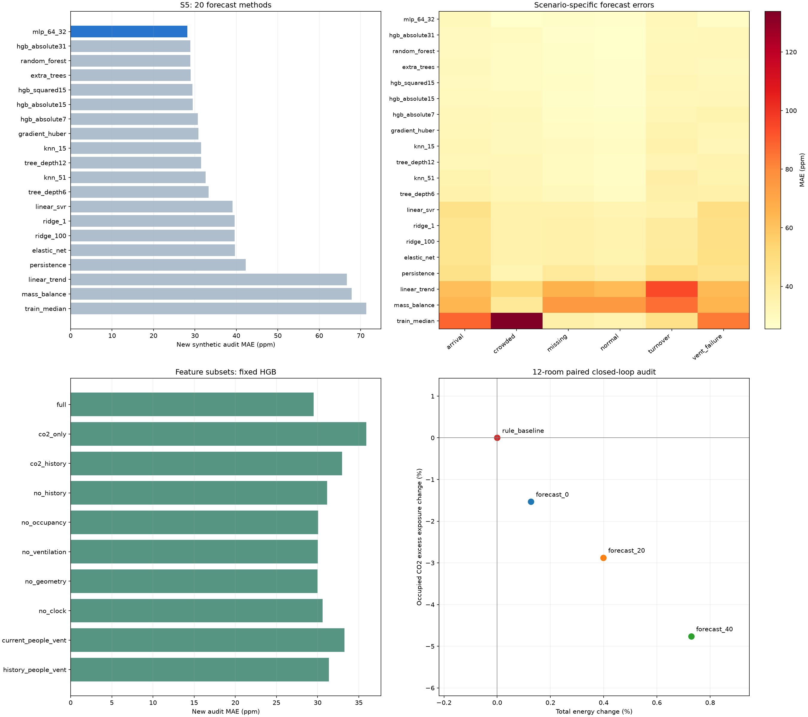

# S5 다방면 비교 분석

검토일 2026-11-05. 가상 센서·재실·공간 프로필과 가상 환기 제어만 사용했다. 기존 S5 v1 및 S1 실험·앱 모델은 교체하지 않았다.

## 결과 요약

- 검증에서 선택한 **mlp_64_32**의 새 시험 MAE는 **28.138ppm**, 지속값은 **42.245ppm**이다. 같은 자료의 미래 CO₂≥890ppm 판정 F1은 **0.744**, 지속값은 **0.659**다.
- S1에서 유리했던 HGB와 달리 이번 S5에서는 MLP가 검증에서 선택됐다. 모든 문제에 한 모델이 가장 좋은 것은 아니다.
- 예측20방식·특징10구성·잔차예측2방식·그룹/시간제외14설정·학습량4단계·제어4방식을 비교했다. **54개 실험/비교 설정**이며 일부는 공통 기준선을 재사용한다. 12개 분류 축의 세부 결과 2,000행을 저장했다.
- 실제 제어 효과는 **고정 12실**에서 같은 외기·인원·고장 조건의 72개 폐루프 실행으로 비교했다. 검증에서 선택한 **forecast_40**를 새 시험에도 그대로 적용했다.
- 새 시험에서 선택 정책의 초과 공간·분은 **9,149→8,064**, 총전력은 **121.707→122.594kWh**였다. 다른 지표와 상황별 차이는 아래 표를 함께 봐야 한다.

## 1. 실험 범위와 데이터 분리

예측은63실, 제어는 각 건물의 가상 정원이 작은·중간·큰 공간을 사전에 선택한12실이다. 제어 공간 ID: `HEA-421, HEA-423, HEA-424, LIB-B101A, LIB-B101G, LIB-B101H, STU-201C, STU-B118, STU-B131, WON-619A, WON-701A, WON-701B`. 나머지51실의 제어 효과를 검증한 것은 아니다.

train seed1301/1302, validation2301, 새 시험6401/6402를 분리했다. 날짜는 train9/2·9/16, validation9/23, 새 시험9/30·10/1이다. 09~10시 워밍업, 10~13시만 평가한다. 각 공간의 재실은 상황별 이항분포로 생성하며 실제 예약 자료가 아니다.

상황6개: 보통 재실·높은 재실·급격한 입실·빠른 인원 변화·CO₂ 결측·일부 환기 작동 실패. 고장 상황은 이 비교를 위한 인위적 설정이며 교수의 미확보된 유형0 정의를 구현한 것이 아니다.

학습16,248행, 검증8,124행, 새 시험16,248행이다. 목표는 정확히8분 뒤 **관측 CO₂**다. 현재 CO₂ 또는 미래 목표가 결측인 학습/평가 행은 제외하지만, 화면용 입력은 미래 정답 유무로 제외하지 않는다. 결측 상황의 낮은 오차가 모든 결측을 해결했다는 의미는 아니다.

13개 특징은 현재/과거 CO₂, 현재 재실, 관측 환기 상태, 가상 부피/ACH, 시각·요일이다. 미래 인원·미래 설비·truth·고장 플래그·에너지는 모델 입력이 아니다. 모델 전처리는 train에서만 fit했다. 모델 선택과 제어 선택을 검증에서 끝내고 기록한 뒤 새 시험을 생성했다.

## 2. 예측 방식20개

MAE/RMSE는ppm 단위로 낮을수록 좋다. F1은 미래 관측 CO₂가890ppm 이상인지의 판정으로 높을수록 좋다. 센서 고장 탐지 F1이나 공식 안전 기준 판정이 아니다. MLP는 표준화된 입력과 목표를 사용하고, HGB는 다양한 잎 수·손실함수를 비교했다.

| 방법 | 검증 MAE | 새 시험 MAE | 새 시험 RMSE | 미래 초과 F1 | 미래 초과 재현율 | 수렴 경고 없음 |
| --- | --- | --- | --- | --- | --- | --- |
| mlp_64_32 | 28.777 | 28.138 | 35.999 | 0.744 | 0.715 | True |
| hgb_absolute31 | 29.544 | 28.862 | 37.682 | 0.733 | 0.649 | True |
| random_forest | 29.784 | 28.916 | 37.546 | 0.742 | 0.692 | True |
| extra_trees | 29.595 | 28.957 | 37.044 | 0.740 | 0.693 | True |
| hgb_squared15 | 29.992 | 29.406 | 37.569 | 0.740 | 0.696 | True |
| hgb_absolute15 | 30.164 | 29.502 | 38.650 | 0.728 | 0.642 | True |
| hgb_absolute7 | 31.407 | 30.712 | 40.414 | 0.714 | 0.624 | True |
| gradient_huber | 31.291 | 30.837 | 39.712 | 0.716 | 0.647 | True |
| knn_15 | 32.233 | 31.460 | 40.278 | 0.720 | 0.668 | True |
| tree_depth12 | 32.741 | 31.471 | 41.241 | 0.714 | 0.653 | True |
| knn_51 | 33.214 | 32.558 | 42.023 | 0.709 | 0.651 | True |
| tree_depth6 | 34.323 | 33.282 | 43.377 | 0.705 | 0.633 | True |
| linear_svr | 39.812 | 39.041 | 52.816 | 0.687 | 0.650 | True |
| ridge_1 | 40.251 | 39.604 | 51.560 | 0.669 | 0.671 | True |
| ridge_100 | 40.246 | 39.615 | 51.556 | 0.670 | 0.671 | True |
| elastic_net | 40.253 | 39.646 | 51.557 | 0.670 | 0.672 | True |
| persistence | 43.000 | 42.245 | 55.394 | 0.659 | 0.662 | True |
| linear_trend | 67.595 | 66.701 | 85.756 | 0.607 | 0.654 | True |
| mass_balance | 68.057 | 67.832 | 91.360 | 0.587 | 0.648 | True |
| train_median | 73.160 | 71.357 | 119.806 | 0.000 | 0.000 | True |

단순 추세는 현재 CO₂+8×과거 분당 변화, 물질수지는 현재 인원·환기량이8분간 유지된다고 가정한 해석식이다. 실제 가상 환경에서는 인원과 환기 명령이 변하므로 이 가정이 깨진다. 해석식의 오차가 컸다고 물리 모델 전체가 쓸모없다는 뜻은 아니다.

기존 v1 모델을 같은 새 시험에 그대로 적용한 MAE는 **61.061ppm**이었다. v1은 대표4실·다른 기간과 분포에서 학습했으므로 순수 알고리즘 우열 비교가 아니다. 원래 v1 시험 MAE19.126ppm과 이번 새 시험 값을 직접 비교해 개선/악화를 단정하지 않는다.

## 3. 데이터를 나눠 확인한 결과

아래는 선택 모델의 새 시험 내부 비교다. 각 그룹의 분모와 실제 미래 초과 비율을 같이 본다. 초과 사례가 없는 그룹의 F1/재현율은 계산 규칙상0으로 저장되며 그 자체로 예측 실패를 뜻하지 않는다. 그룹별 수치는 기술통계이며 독립적인 검정 결과가 아니다.

### 가상 상황

| 구분 | 행 수 | MAE (ppm) | 미래 초과 F1 | 초과 재현율 | 실제 미래 초과 비율 |
| --- | --- | --- | --- | --- | --- |
| arrival | 2772 | 31.023 | 0.763 | 0.748 | 0.351 |
| crowded | 2772 | 25.541 | 0.893 | 0.874 | 0.839 |
| missing | 2388 | 27.081 | 0.336 | 0.305 | 0.173 |
| normal | 2772 | 26.236 | 0.325 | 0.286 | 0.166 |
| turnover | 2772 | 31.076 | 0.746 | 0.730 | 0.557 |
| vent_failure | 2772 | 27.726 | 0.701 | 0.653 | 0.331 |
### 건물

| 구분 | 행 수 | MAE (ppm) | 미래 초과 F1 | 초과 재현율 | 실제 미래 초과 비율 |
| --- | --- | --- | --- | --- | --- |
| HEA | 1032 | 31.565 | 0.748 | 0.727 | 0.429 |
| LIB | 3096 | 28.292 | 0.790 | 0.762 | 0.455 |
| STU | 9804 | 27.906 | 0.738 | 0.709 | 0.395 |
| WON | 2316 | 27.389 | 0.695 | 0.665 | 0.393 |
### 시간대

| 구분 | 행 수 | MAE (ppm) | 미래 초과 F1 | 초과 재현율 | 실제 미래 초과 비율 |
| --- | --- | --- | --- | --- | --- |
| 10 | 5984 | 29.473 | 0.728 | 0.713 | 0.389 |
| 11 | 5164 | 27.901 | 0.792 | 0.768 | 0.466 |
| 12 | 5100 | 26.813 | 0.701 | 0.651 | 0.373 |
### 재실 비율

| 구분 | 행 수 | MAE (ppm) | 미래 초과 F1 | 초과 재현율 | 실제 미래 초과 비율 |
| --- | --- | --- | --- | --- | --- |
| high_70_100 | 4571 | 27.587 | 0.865 | 0.876 | 0.706 |
| low_0_30 | 6771 | 29.217 | 0.623 | 0.555 | 0.264 |
| mid_30_70 | 4906 | 27.163 | 0.610 | 0.571 | 0.330 |
### 현재 CO₂ 구간

| 구분 | 행 수 | MAE (ppm) | 미래 초과 F1 | 초과 재현율 | 실제 미래 초과 비율 |
| --- | --- | --- | --- | --- | --- |
| 1100plus | 1083 | 23.450 | 1.000 | 0.999 | 0.999 |
| 700to850 | 4168 | 28.463 | 0.372 | 0.294 | 0.212 |
| 850to890 | 4871 | 29.262 | 0.496 | 0.462 | 0.278 |
| 890to1100 | 5610 | 27.561 | 0.833 | 0.838 | 0.590 |
| below700 | 516 | 31.018 | 0.000 | 0.000 | 0.002 |
### 현재 관측 환기 상태

| 구분 | 행 수 | MAE (ppm) | 미래 초과 F1 | 초과 재현율 | 실제 미래 초과 비율 |
| --- | --- | --- | --- | --- | --- |
| off | 7642 | 29.348 | 0.616 | 0.535 | 0.254 |
| on | 8606 | 27.064 | 0.790 | 0.790 | 0.545 |
### 가상 부피

| 구분 | 행 수 | MAE (ppm) | 미래 초과 F1 | 초과 재현율 | 실제 미래 초과 비율 |
| --- | --- | --- | --- | --- | --- |
| 150plus | 1056 | 28.026 | 0.718 | 0.666 | 0.391 |
| 75to150 | 6924 | 25.812 | 0.756 | 0.731 | 0.405 |
| below75 | 8268 | 30.100 | 0.737 | 0.708 | 0.413 |
### 환기 켜짐 시 가상 ACH

| 구분 | 행 수 | MAE (ppm) | 미래 초과 F1 | 초과 재현율 | 실제 미래 초과 비율 |
| --- | --- | --- | --- | --- | --- |
| 2.5to3.5 | 5652 | 26.534 | 0.796 | 0.781 | 0.457 |
| 3.5plus | 7728 | 30.164 | 0.614 | 0.561 | 0.312 |
| below2.5 | 2868 | 25.839 | 0.839 | 0.838 | 0.571 |
### 새 시험 seed

| 구분 | 행 수 | MAE (ppm) | 미래 초과 F1 | 초과 재현율 | 실제 미래 초과 비율 |
| --- | --- | --- | --- | --- | --- |
| 6401 | 8124 | 28.352 | 0.741 | 0.709 | 0.411 |
| 6402 | 8124 | 27.924 | 0.747 | 0.721 | 0.405 |
### 과거 이력 결측

| 구분 | 행 수 | MAE (ppm) | 미래 초과 F1 | 초과 재현율 | 실제 미래 초과 비율 |
| --- | --- | --- | --- | --- | --- |
| complete | 16120 | 28.086 | 0.745 | 0.715 | 0.410 |
| missing | 128 | 34.693 | 0.562 | 0.720 | 0.195 |
### 현재 CO₂ 추세

| 구분 | 행 수 | MAE (ppm) | 미래 초과 F1 | 초과 재현율 | 실제 미래 초과 비율 |
| --- | --- | --- | --- | --- | --- |
| falling | 6860 | 28.369 | 0.702 | 0.682 | 0.416 |
| rising | 7288 | 28.090 | 0.786 | 0.747 | 0.402 |
| stable | 1972 | 27.091 | 0.750 | 0.717 | 0.420 |
| unknown | 128 | 34.693 | 0.562 | 0.720 | 0.195 |
### 공간별 차이

63실 전체는 subgroup_audit.csv에 있다. 아래는 예측 오차가 큰 10실이며 실제 시설 품질 순위가 아니다.

| group | n | mae_ppm | future_exceedance_f1 |
| --- | --- | --- | --- |
| STU-201C | 252 | 36.310 | 0.580 |
| HEA-422 | 264 | 35.393 | 0.655 |
| STU-B117 | 264 | 35.348 | 0.867 |
| LIB-B101E | 252 | 34.989 | 0.599 |
| STU-B126 | 264 | 34.145 | 0.522 |
| LIB-B101I | 252 | 33.584 | 0.734 |
| STU-B102C | 264 | 32.431 | 0.424 |
| STU-B102A | 264 | 32.312 | 0.413 |
| WON-701A | 252 | 32.135 | 0.452 |
| WON-704 | 252 | 31.732 | 0.533 |

재실 비율은0~30%,30~70%,70~100%로, 부피는75/150m³, 켜짐ACH는2.5/3.5를 경계로 나눴다. CO₂ 구간은 하한 포함·상한 미포함이다. 추세는 과거8분 평균 변화율−1~1ppm/분을 안정 구간으로 두었다. 과거 관측이 없어 추세를 계산하지 못하는128행은 unknown(추세 미확인)으로 포함했다. 모든 분류별 행 수 합계가 새 시험16,248행과 일치하는 것을 검증했다. 이 분석 구간은 제어 기준을 변경하지 않는다.

## 4. 어떤 입력이 필요한가

고정 HGB를 사용해 특징의 영향을 비교했다. `no_history`는lag1/lag8/추세, `no_ventilation`은관측 환기 켜짐/단계, `no_geometry`는부피/ACH를 제외한다.

| 특징 구성 | 특징 수 | 새 시험 MAE ppm | 미래 초과 F1 |
| --- | --- | --- | --- |
| full | 13 | 29.502 | 0.728 |
| co2_only | 1 | 35.907 | 0.647 |
| co2_history | 4 | 32.957 | 0.697 |
| no_history | 10 | 31.163 | 0.688 |
| no_occupancy | 12 | 30.051 | 0.716 |
| no_ventilation | 11 | 30.022 | 0.722 |
| no_geometry | 10 | 29.985 | 0.722 |
| no_clock | 10 | 30.616 | 0.719 |
| current_people_vent | 4 | 33.239 | 0.672 |
| history_people_vent | 7 | 31.373 | 0.713 |

현재 CO₂만 쓰는 것보다 과거 이력·재실·환기 상태·가상 공간 특성을 함께 쓰는 쪽이 이번 예측에 도움이 됐다. 특정 특징을 제거했을 때 작은 차이가 났다는 이유로 실제 제어에 필요한 현재 상태 정보까지 삭제하면 안 된다. 이 실험의 가상 ACH/정원을 실제 측정값으로 해석하지 않는다.

## 5. 변화량 예측·학습량 비교

미래 CO₂−현재 CO₂를 학습한 뒤 현재값을 더하는 잔차 방식도 별도로 비교했다. 주 모델의 선택을 사후 변경하지 않았다.

| method | split | mae_ppm | future_exceedance_f1 |
| --- | --- | --- | --- |
| ridge_delta | validation | 40.252 | 0.687 |
| hgb_delta | validation | 29.627 | 0.739 |
| ridge_delta | audit | 39.609 | 0.670 |
| hgb_delta | audit | 29.185 | 0.724 |

학습량 비교는 고정 HGB와 같은 새 시험을 사용했다. seed·상황·공간별 층화 표본이며 동일 seed의 연관된 행을 늘리는 것과 독립적인 상황/seed를 늘리는 것은 다르다.

| train_fraction | train_rows | mae_ppm | future_exceedance_f1 |
| --- | --- | --- | --- |
| 0.100 | 1512 | 32.780 | 0.688 |
| 0.250 | 4408 | 30.649 | 0.720 |
| 0.500 | 8124 | 30.153 | 0.723 |
| 1.000 | 16248 | 29.502 | 0.728 |

## 6. 학습에서 특정 그룹을 빼면

고정 HGB로 특정 건물·상황·학습 seed를 제외했다. 시간 제외는 목표시각이11시/12시 이전인 행만 학습하고 새 시험의 그 이후 시간대를 평가했다. 전체학습 대조 모델도 반드시 같은 시험 행에서 계산했다.

| 제외 기준 | 제외 그룹 | 학습 행 | 시험 행 | 제외 학습 MAE | 같은 행 전체학습 MAE | 지속값 MAE |
| --- | --- | --- | --- | --- | --- | --- |
| building | HEA | 15216 | 1032 | 34.672 | 33.991 | 49.312 |
| building | LIB | 13152 | 3096 | 32.481 | 30.875 | 44.994 |
| building | STU | 6444 | 9804 | 30.232 | 28.841 | 41.104 |
| building | WON | 13932 | 2316 | 28.773 | 28.462 | 40.254 |
| scenario | arrival | 13476 | 2772 | 42.051 | 30.072 | 46.278 |
| scenario | crowded | 13476 | 2772 | 47.813 | 29.867 | 33.662 |
| scenario | missing | 13860 | 2388 | 29.058 | 27.136 | 40.807 |
| scenario | normal | 13476 | 2772 | 27.533 | 26.190 | 37.303 |
| scenario | turnover | 13476 | 2772 | 53.424 | 31.415 | 49.412 |
| scenario | vent_failure | 13476 | 2772 | 40.982 | 32.004 | 45.809 |
| seed | 1301 | 8124 | 16248 | 30.396 | 29.502 | 42.245 |
| seed | 1302 | 8124 | 16248 | 30.332 | 29.502 | 42.245 |
| time_cutoff | 11 | 5292 | 10264 | 34.713 | 29.202 | 41.514 |
| time_cutoff | 12 | 10392 | 5100 | 31.888 | 28.876 | 42.150 |

이 결과는 학습에 포함하지 않은 상황의 민감도를 보여 준다. 그룹 제외 진단으로 모델을 다시 선택한 것은 아니다. 많은 행이 있어도 급격한 입실·혼잡·고장 같은 상황이 빠지면 일반화에 한계가 생길 수 있다.

## 7. 예측이 실제 가상 제어에 도움이 되는가

이 부분은 예측 CSV의 오차 비교와 별도로 엔진을 다시 실행한 **폐루프 비교**다. 각 정책의 명령이 다음 분의 환경을 바꾸고, 새 센서 관측을 보고 다시 판단한다. CO₂ 노출은 환경truth, 전력은 적용된 설비 상태로 평가한다. 이 평가용 truth·고장 정보는 정책 입력에 전달하지 않는다.

모든 정책은 현재 CO₂≥890ppm 켜기, ≤850ppm 해제, 최소 가동5분을 유지한다. 예측 보조는 현재850~890ppm의 상태유지 구간에서만 미리 켤 수 있다. `forecast_20/40`은 예측값에20/40ppm을 더해890과 비교한다. 이는 제어 여유값 실험이며 보정된 신뢰구간이나 안전 보장이 아니다.

검증에서는 기본 정책보다 초과 노출이 줄고 총전력이5% 이내 증가하는 후보 중 초과 노출이 가장 작은 방식을 선택했다. 새 시험 결과로 정책을 바꾸지 않았다. 고장 상황에서는 환기 켜기 요청과 실제 적용 상태를 구분했고, 작동 실패한 장치를 예측만으로 복구하지 않는다.

### 새 시험12실 합계

| 제어 방식 | 재실 중 기준 초과 공간·분 | 초과 노출 ppm·공간·분 | 총전력 kWh | 환기 전력 kWh | 환기 전환 요청 | 최대 CO₂ ppm |
| --- | --- | --- | --- | --- | --- | --- |
| forecast_0 | 8769 | 914115.387 | 121.861 | 29.371 | 2373 | 1712.948 |
| forecast_20 | 8430 | 901645.249 | 122.192 | 29.756 | 2462 | 1691.056 |
| forecast_40 | 8064 | 884136.997 | 122.594 | 30.158 | 2546 | 1691.056 |
| rule_baseline | 9149 | 928331.280 | 121.707 | 29.216 | 2314 | 1712.948 |

선택 정책의 초과 노출 변화는 **-4.76%**, 총전력 변화는 **0.73%**, 환기 전력 변화는 **3.22%**다. 총전력에는 냉난방·조명·대기전력도 들어가므로 환기 전력과 따로 본다.

공간·분은 여러 공간의 재실 시간을 더한 단위다. 초과 노출은max(CO₂−890,0)을 재실 공간·분에 누적한 값이다. 이 수치는 한 공간의 실제 경과시간·학교 전체 절감량이 아니다. 전환 요청 수는 가상 제어 명령의 변화 횟수다.

### 상황별로 선택 정책과 기본 정책 비교

| 상황 | 초과 공간·분 변화 | 초과 노출 변화 (%) | 총전력 변화 (%) |
| --- | --- | --- | --- |
| normal | -204.000 | -16.293 | 1.186 |
| crowded | -9.000 | -0.066 | 0.003 |
| arrival | -183.000 | -9.816 | 1.272 |
| turnover | -238.000 | -2.552 | 0.468 |
| missing | -288.000 | -52.056 | 1.600 |
| vent_failure | -163.000 | -5.345 | 1.291 |

전체 합계가 좋아도 특정 상황의 모든 지표가 좋아진 것은 아니다. 환기 실패·미관측 구간에서 남는 초과 노출, 전력과 전환 횟수 증가를 함께 확인해야 한다. 검증의5% 전력 기준은 선택 기준이지 새 시험에서도 자동으로 보장되는 조건이 아니다.

## 8. 현재 결론과 제한

1. 예측 모델 선택, 미래 초과 분류, 제어 효과를 별도로 평가했다. 한 지표만으로 모든 성능을 주장하지 않는다.
2. 예측은63실이지만 제어 효과는12실·10~13시·한정된 가상 인원/고장 규칙이다. 기존4실 실험보다 범위를 넓혔으나 나머지51실·전일·다른 계절을 검증하지 않았다.
3. 새 시험 seed는2개이며 통계적 유의성이나 실제 장치 효과를 주장하지 않는다. 전력·공기질은 합성 가정에 따른 결과다.
4. 모델이 미래 실제 인원이나 고장 발생 시각을 미리 알지 못하므로 빠른 인원 변화와 결측에서 성능 한계가 남는다. 가상 유형0 정의를 임의로 채우지 않았다.
5. 기존 S5 앱과 모델은 그대로 유지했다. 비교 실험의 모델·제어 정책을 실제 장치나 기존 앱에 자동 적용하지 않았다.

## 9. 결과 파일

- `model_validation.csv`, `model_audit.csv`:20개 방식의 예측·초과판정 성능
- `subgroup_audit.csv`:12개 분류 축·공간별63실 등 세부 결과
- `feature_validation.csv`, `feature_audit.csv`:10가지 특징 구성
- `generalization_audit.csv`:14가지 그룹/시간 제외 실험
- `residual_forecast.csv`, `learning_curve.csv`:잔차예측·학습량 비교
- `closed_loop_validation.csv`, `closed_loop_audit.csv`, `closed_loop_audit_totals.csv`:72개 제어 실행과 효과
- `controls/*/trace.csv.gz`:현재 관측·평가용 환경truth·예측·다음 요청·적용 상태
- `audit_dataset.csv.gz`, `audit_predictions.csv.gz`, `audit_inference_inputs.csv.gz`:새 시험 근거와 정답 없는 입력
- `plan.json`, `model_selection.json`, `control_selection.json`, `summary.json`, `verification.json`:계획·선택·검증 근거

재현 도구는 `run_comparison.py`, 결과 검증은 `verify_results.py`, 이 문서 생성은 `build_report.py`다. 주 실험은 기존 결과가 있으면 덮어쓰지 않는다.

검증 결과: 신규 테스트4개 통과. 저장된20모델 예측에서MAE와F1을 다시 계산했고, 72개 제어 추적에서 재실 중 초과 노출·환기 전력을 재구성했다. 같은 외생 조건·최소가동시간·검증 자료만 이용한 선택·기존 모델 해시도 확인했다. 총전력의 냉난방/조명/대기전력 항목은 엔진 적산값이며, 환기 전력 항목은 적용 상태와 가상 정격전력으로 독립 재계산했다.
