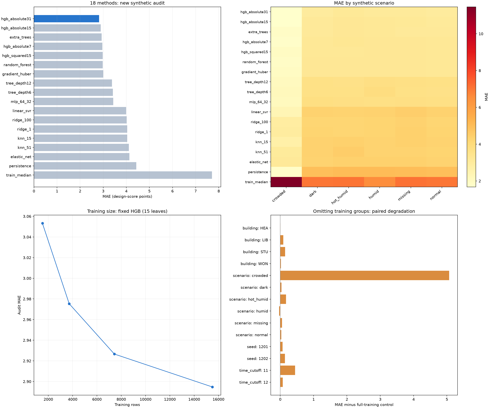

# S1 다방면 비교 실험 v3

실험 시작 2026-11-04, 결과 검수 2026-11-05. 실제 센서·만족도·예약 기록을 사용하지 않았다. 선문대 공간 식별 목록에 대응하는 63실의 센서·정원·환경 프로필은 가상이다. 기존 v1/v2와 앱의 추천 방식은 변경하지 않았다.

## 먼저 확인할 결과

- **검증에서 선택한 `hgb_absolute31`가 새 시험에서도 MAE 2.819점으로 가장 낮았다.** 같은 시험의 지속값은4.435점이다. 실제 만족도 정확도가 아니라 다음8분의 가상 설계 환경 점수 오차다.
- 혼잡 상황을 학습에서 빼면 고정 HGB의 해당 상황 MAE가 **1.683→6.749점**으로 증가했다. 여러 모델을 바꾸는 것만큼 학습 데이터에 다양한 상황을 포함하는 것이 중요하다.
- 현재 점수를 제거한 추가 특징 실험에서는 좌석/재실을 더 제거했을 때 **3.008→4.177점**, 습도를 제거하면 **3.008→3.508점**으로 증가했다. 이 데이터 생성·점수 규칙에서 유용한 정보이지 모든 실제 학생에게 적용되는 인과적 중요도는 아니다.
- 예측점수 정렬은 현재 점수 정렬보다 새 시험의 순위 손실은 작았지만 미래 조건 위반율은 **15.10%→23.96%**로 높았다. 검증에서도 예측 정렬 채택 기준을 통과하지 못해 **현재 점수 정렬 유지**가 선택됐다.
- 18개 모델·10개 기본 특징 구성·7개 추가 특징 구성·2개 잔차 예측·14개 그룹 제외·4개 학습량·8개 정렬 방식, 총63개 실험/비교 설정을 계산했다. 일부 설정은 공통 기준선을 재사용하며 독립적인63개 데이터셋이나 통계 검정이 아니다. 13개 분류 축으로 **1,764개 세부 성능 행**도 저장했다.

## 1. 공정하게 비교한 범위

v2의 train15,492행·validation7,746행으로 모든 후보를 비교했다. 입력 조건은p=2·q=3, 10시 시작·8분 창·890/850ppm·기존 선호 가중치를 유지했다. 전처리는 train에서만 fit했다. HGB 조기종료의 무작위 내부 분할과 MLP의 내부 무작위 검증은 사용하지 않았다.

모델과 추천정렬을 validation에서 선택한 뒤 `selection.json`을 저장했다. 그 다음 새 seed5401/5402, 9/30·10/1의6개 상황을 생성했다. 새 시험은15,492행, 12개 실행, 252개 실행·시각이다. 원시 관측은136,080행이다. 알려진v2 시험 자료를 새 최종 선택에 재사용하지 않았다.

주요 모델은 같은15특징·같은학습 행·같은새 시험행을 사용했다. 트리 복잡도와 후보 설정은 `plan.json`에 먼저 기록했다. 추가 특징/잔차 실험은 주 모델 선택을 변경하지 않는 진단용이다. 광범위 비교를 했지만 모든 하이퍼파라미터를 탐색한 것은 아니다.

## 2. 모델18개 비교

낮을수록 좋다. 검증에서 수렴 경고가 있는 후보는 선택 대상에서 제외했다. 시험 결과가 가장 좋은 방법을 사후에 채택한 것이 아니다.

| 방법 | 검증 MAE | 새 시험 MAE | 새 시험 RMSE | 새 시험 절대오차95%값 | 수렴 경고 없음 |
| --- | --- | --- | --- | --- | --- |
| hgb_absolute31 | 2.781 | 2.819 | 4.623 | 10.852 | True |
| hgb_absolute15 | 2.850 | 2.895 | 4.738 | 10.953 | True |
| extra_trees | 2.857 | 2.932 | 4.486 | 10.398 | True |
| hgb_absolute7 | 2.903 | 2.963 | 4.787 | 11.055 | True |
| hgb_squared15 | 2.936 | 2.976 | 4.611 | 10.786 | True |
| random_forest | 2.905 | 2.983 | 4.683 | 10.468 | True |
| gradient_huber | 2.965 | 3.004 | 4.636 | 10.760 | True |
| tree_depth12 | 3.268 | 3.381 | 5.189 | 11.435 | True |
| tree_depth6 | 3.340 | 3.418 | 5.133 | 11.071 | True |
| mlp_64_32 | 3.292 | 3.435 | 5.117 | 11.301 | True |
| linear_svr | 3.757 | 3.992 | 6.133 | 14.850 | True |
| ridge_100 | 3.849 | 4.018 | 5.945 | 14.092 | True |
| ridge_1 | 3.862 | 4.040 | 5.911 | 14.046 | True |
| knn_15 | 3.770 | 4.043 | 5.887 | 12.814 | True |
| knn_51 | 3.854 | 4.112 | 5.894 | 13.069 | True |
| elastic_net | 3.928 | 4.132 | 6.111 | 14.184 | True |
| persistence | 4.216 | 4.435 | 7.171 | 16.453 | True |
| train_median | 7.432 | 7.705 | 10.566 | 20.266 | True |

모델별 원본 수치는 `artifacts/model_validation.csv`, `model_audit.csv`다. 실행시간도 저장했으나 단일 장비·한 번의 실행값으로 안정적인 속도 순위나 배포 지연시간을 주장하지 않는다.

## 3. 데이터를13개 기준으로 나눠 확인

아래는 검증에서 선택한 모델의 **같은 새 시험 데이터 내부 세부 비교**다. 각 그룹의 행 수가 다르므로 이를 독립 실험·실제 건물 평가로 해석하지 않는다. 그룹별 가장 좋은 모델은 탐색적 결과일 뿐 새 모델 선택 근거로 쓰지 않았다.

### 가상 상황

| 구분 | 평가 행 수 | MAE | RMSE | 절대오차95%값 |
| --- | --- | --- | --- | --- |
| crowded | 2646.000 | 1.676 | 2.699 | 5.572 |
| dark | 2646.000 | 3.013 | 4.909 | 11.463 |
| hot_humid | 2646.000 | 3.145 | 4.952 | 11.392 |
| humid | 2646.000 | 3.058 | 4.917 | 11.478 |
| missing | 2262.000 | 3.055 | 4.969 | 11.592 |
| normal | 2646.000 | 3.001 | 4.895 | 11.596 |
### 건물

| 구분 | 평가 행 수 | MAE | RMSE | 절대오차95%값 |
| --- | --- | --- | --- | --- |
| HEA | 984.000 | 3.151 | 5.327 | 11.645 |
| LIB | 2952.000 | 3.549 | 5.867 | 13.508 |
| STU | 9348.000 | 2.639 | 4.276 | 10.036 |
| WON | 2208.000 | 2.459 | 3.726 | 8.067 |
### 시간대

| 구분 | 평가 행 수 | MAE | RMSE | 절대오차95%값 |
| --- | --- | --- | --- | --- |
| 10 | 5292.000 | 2.766 | 4.566 | 11.324 |
| 11 | 5100.000 | 3.048 | 4.854 | 10.873 |
| 12 | 5100.000 | 2.645 | 4.442 | 10.097 |
### 혼잡도

| 구분 | 평가 행 수 | MAE | RMSE | 절대오차95%값 |
| --- | --- | --- | --- | --- |
| high_70_100 | 2603.000 | 1.898 | 3.191 | 6.473 |
| low_0_30 | 6650.000 | 3.473 | 5.582 | 12.506 |
| mid_30_70 | 6239.000 | 2.506 | 3.952 | 9.496 |
### 습도 구간

| 구분 | 평가 행 수 | MAE | RMSE | 절대오차95%값 |
| --- | --- | --- | --- | --- |
| 40to60 | 10833.000 | 2.738 | 4.556 | 10.765 |
| 60to75 | 1872.000 | 2.974 | 4.751 | 10.966 |
| 75plus | 2318.000 | 3.158 | 4.974 | 11.262 |
| below40 | 469.000 | 2.402 | 3.781 | 9.280 |
### CO₂ 구간

| 구분 | 평가 행 수 | MAE | RMSE | 절대오차95%값 |
| --- | --- | --- | --- | --- |
| 1100plus | 587.000 | 1.373 | 2.087 | 4.661 |
| 700to890 | 11958.000 | 2.988 | 4.852 | 11.359 |
| 890to1100 | 2914.000 | 2.415 | 3.996 | 9.050 |
| below700 | 33.000 | 3.045 | 4.275 | 9.718 |
### 소음 구간

| 구분 | 평가 행 수 | MAE | RMSE | 절대오차95%값 |
| --- | --- | --- | --- | --- |
| over45 | 8458.000 | 1.987 | 3.159 | 6.945 |
| within45 | 7034.000 | 3.819 | 5.922 | 13.437 |
### 여유좌석 여부

| 구분 | 평가 행 수 | MAE | RMSE | 절대오차95%값 |
| --- | --- | --- | --- | --- |
| available | 14734.000 | 2.865 | 4.696 | 10.958 |
| full | 758.000 | 1.930 | 2.877 | 5.615 |
### 새 시험 seed

| 구분 | 평가 행 수 | MAE | RMSE | 절대오차95%값 |
| --- | --- | --- | --- | --- |
| 5401 | 7746.000 | 2.750 | 4.585 | 10.843 |
| 5402 | 7746.000 | 2.888 | 4.662 | 10.848 |
### 현재 조건 충족 여부

| 구분 | 평가 행 수 | MAE | RMSE | 절대오차95%값 |
| --- | --- | --- | --- | --- |
| qualified | 4102.000 | 3.657 | 5.688 | 13.112 |
| unqualified | 11390.000 | 2.517 | 4.174 | 9.541 |
### 과거 변화 특징 결측

| 구분 | 평가 행 수 | MAE | RMSE | 절대오차95%값 |
| --- | --- | --- | --- | --- |
| complete | 14736.000 | 2.906 | 4.727 | 11.039 |
| missing | 756.000 | 1.130 | 1.560 | 3.296 |
### 현재 창 CO₂ 일부 결측

| 구분 | 평가 행 수 | MAE | RMSE | 절대오차95%값 |
| --- | --- | --- | --- | --- |
| complete | 15492.000 | 2.819 | 4.623 | 10.852 |
### 공간별 차이

63실 전체 값은 `artifacts/subgroup_audit.csv`의 dimension=room에 있다. 아래는 오차가 큰10실이다. 실제 건물의 품질 순위가 아닌 가상 모델의 예측 오차다.

| group | n | mae | p95_absolute_error |
| --- | --- | --- | --- |
| HEA-422 | 252.000 | 5.607 | 20.196 |
| STU-B102C | 252.000 | 5.497 | 15.275 |
| LIB-B101E | 240.000 | 5.340 | 18.725 |
| LIB-B101G | 240.000 | 4.886 | 17.339 |
| STU-201C | 240.000 | 4.870 | 16.995 |
| LIB-B101A | 240.000 | 4.708 | 17.763 |
| STU-201I | 240.000 | 4.667 | 13.270 |
| LIB-B101J | 252.000 | 4.591 | 14.315 |
| STU-410 | 240.000 | 4.295 | 12.906 |
| STU-B117 | 252.000 | 4.200 | 15.951 |

혼잡도는 재실/가상 정원 비율을0~30%, 30~70%, 70~100%로 나눴다. 습도 구간40to60은40이상60미만, co2 구간700to890은700이상890미만 등이다. 분석용 구간 경계와 후보 검사(습도40~60 포함)는 다를 수 있다. 매우 작은 그룹의 오차는 안정적인 비교 근거가 아니다.

## 4. 입력 특징을 바꾸면

고정 HGB(15개 잎)를 사용해 모델 차이와 특징 차이를 분리했다. `no_score`는현재 점수, `no_changes`는과거 변화, `no_clock`은시각·요일을 제외한다.

| 제외/구성 | 특징 수 | 새 시험 MAE |
| --- | --- | --- |
| full | 15.000 | 2.895 |
| no_score | 14.000 | 3.008 |
| no_humidity | 14.000 | 2.876 |
| no_noise | 13.000 | 3.064 |
| no_co2 | 12.000 | 2.909 |
| no_light | 14.000 | 2.879 |
| no_seats | 13.000 | 3.417 |
| no_clock | 12.000 | 2.890 |
| no_changes | 12.000 | 2.955 |
| sensors_only | 7.000 | 3.022 |

**현재 점수에는 이미 온습도·CO₂·소음·조도·혼잡 정보가 요약되어 있다.** 따라서 습도열만 빼도 습도 정보가 완전히 없어진 것은 아니다. 이를 보완해 현재 점수를 모든 구성에서 먼저 제거하고 각 정보를 추가 제거했다.

| 현재 점수 제거 후 추가 제외 | 특징 수 | 새 시험 MAE |
| --- | --- | --- |
| none | 14.000 | 3.008 |
| humidity | 13.000 | 3.508 |
| temperature | 12.000 | 3.069 |
| co2 | 11.000 | 2.999 |
| noise | 12.000 | 3.212 |
| light | 13.000 | 3.011 |
| seats | 12.000 | 4.177 |

CO₂ 제거 시 오차가 조금 낮아진 결과는 다른 특징과의 중복·이번 생성 패턴·추정 변동의 영향을 포함한다. 후보 검사에서CO₂를 없애도 된다는 의미가 아니다. 습도와 좌석/재실 정보는 이번 점수 예측에서 제거 손실이 컸다. 조도는 영향이 작게 관측됐지만 실제 저조도 방을 추천하는 것을 허용한다는 결론은 아니다.

검증 자료의 순열 중요도도 `validation_permutation_importance.csv`에 저장했다. 현재 점수·재실·소음 순으로 값이 컸다. 상관된 파생 특징의 중요도는 서로 나뉠 수 있으며 인과 효과가 아니다. train 날짜가 모두수요일이므로 weekday 중요도0은요일이항상불필요하다는 증거가 아니다.

## 5. 점수 대신 변화량을 예측하면

목표를 미래 점수−현재 점수로 바꿔 학습하고 추론 시 현재 점수를 더했다. 원래 선택 모델의 채택을 바꾸지 않는 추가 실험이다.

| variant | split | mae |
| --- | --- | --- |
| ridge_delta | validation | 3.941 |
| ridge_delta | fresh_audit | 4.138 |
| hgb_delta | validation | 2.827 |
| hgb_delta | fresh_audit | 2.822 |

HGB잔차 예측은 새 시험2.822점으로 주 모델2.819점과 비슷했다. 이 차이는 두seed만으로 우열을 확정할 근거가 아니다. Ridge잔차 예측은 개선되지 않았다.

## 6. 학습에서 특정 그룹을 제외하면

고정 HGB(15개 잎)로 학습을 반복했다. building/scenario는 해당건물/상황을train에서제외하고 새 시험의같은그룹을평가한다. seed는train seed한개를빼고 새 시험전체를평가한다. time_cutoff는목표 시각이11시/12시이전인train만학습하고 새 시험의그이후시간을평가한다. 모든경우전체 학습모델을**같은 시험 행**에적용한대조값을함께기록했다.

| 분리 기준 | 학습 제외 그룹 | 학습 행 | 시험 행 | 제외 학습 MAE | 같은 시험 행 전체 학습 MAE |
| --- | --- | --- | --- | --- | --- |
| building | HEA | 14508.000 | 984.000 | 3.250 | 3.248 |
| building | LIB | 12540.000 | 2952.000 | 3.750 | 3.659 |
| building | STU | 6144.000 | 9348.000 | 2.851 | 2.707 |
| building | WON | 13284.000 | 2208.000 | 2.531 | 2.510 |
| scenario | crowded | 12846.000 | 2646.000 | 6.749 | 1.683 |
| scenario | dark | 12846.000 | 2646.000 | 3.137 | 3.099 |
| scenario | hot_humid | 12846.000 | 2646.000 | 3.394 | 3.223 |
| scenario | humid | 12846.000 | 2646.000 | 3.147 | 3.179 |
| scenario | missing | 13230.000 | 2262.000 | 3.184 | 3.131 |
| scenario | normal | 12846.000 | 2646.000 | 3.118 | 3.087 |
| seed | 1201 | 7746.000 | 15492.000 | 2.967 | 2.895 |
| seed | 1202 | 7746.000 | 15492.000 | 3.038 | 2.895 |
| time_cutoff | 11 | 4536.000 | 10200.000 | 3.378 | 2.933 |
| time_cutoff | 12 | 9636.000 | 5100.000 | 2.784 | 2.707 |

혼잡 상황 누락에서 가장 큰 악화가 나타났다. 건물 제외는 손실이 상대적으로 작았으나 공간 수·프로필이 가상 고정값이므로 실제 미관측 건물 일반화 성능을 뜻하지 않는다. 이 실험은 주 선택 모델을 다시 고른 교차검증이 아니라 고정 알고리즘의 누락 민감도 검사다.

## 7. 학습량을 줄이면

seed·상황·공간별로 결정적인 난수표본을 뽑아 학습 비율을 비교했다. 작은 그룹의 반올림 때문에 실제행수가 명목비율과 조금 다르다. 입력행은 시간적으로 연관되어 있으므로 학습 행을 늘리는 것과 독립seed를 늘리는 것은 다르다.

| train_fraction | train_rows | mae | rmse |
| --- | --- | --- | --- |
| 0.100 | 1512.000 | 3.053 | 4.824 |
| 0.250 | 3716.000 | 2.975 | 4.781 |
| 0.500 | 7432.000 | 2.927 | 4.787 |
| 1.000 | 15492.000 | 2.895 | 4.738 |

추가 행이 도움이 됐지만10%자료에서도 기본 패턴을 어느정도 학습했다. 향후에는 동일조건행 복제보다 **새seed·시간대·미포함 상황**을 늘리는 쪽을 우선 검토할 근거가 된다.

## 8. 추천 정렬 방식8개 비교

모든 방식은 현재 개인 조건을 충족한 후보 안에서만 정렬한다. CO₂최소·소음최소·현재 점수·예측점수·검증상위3모델평균·위험감점5/10/20을비교했다. 위험모델은train의미래 조건 충족 여부를학습했으며 특징에는미래정답을넣지않았다. 출력은확률보정하지않은점수로, 실제안전확률이아니다.

| 정렬 방식 | 추천 가능 시점 | 순위 손실 | 미래 조건 위반율 (%) |
| --- | --- | --- | --- |
| current | 192.000 | 7.218 | 15.104 |
| forecast | 192.000 | 5.335 | 23.958 |
| min_co2 | 192.000 | 14.869 | 15.625 |
| min_noise | 192.000 | 8.169 | 17.708 |
| ensemble | 192.000 | 5.120 | 24.479 |
| risk_5 | 192.000 | 5.419 | 23.958 |
| risk_10 | 192.000 | 5.784 | 24.479 |
| risk_20 | 192.000 | 5.559 | 22.917 |

순위 손실은 같은 현재 유효 후보 중 미래 설정 점수가 가장 좋은 공간과 선택 공간의 차이다. 미래 조건 위반율은 선택 공간이 다음 8분 창에 하나 이상의 설계 조건을 충족하지 못한 비율이다. 둘은 평가 목적이 다르다. 모든 방식의 현재 조건 위반은 0이었다. 후보가 있는 시점은 192/252이며, 후보 없는 60시점은 이 비율의 분모에 포함하지 않는다.

검증에서는 미래 위반율이 현재 점수 기준선 이하인 방식 중 순위 손실이 작은 방식을 선택했고 현재 점수 정렬이 남았다. 새 시험에서 일부 방식의 순위 손실이 더 낮아도 선택을 뒤집지 않았다. 예측 모델의 MAE 개선만으로 학생 추천 전체가 개선됐다고 말할 수 없다.

## 9. 현재 판단 및 한계

1. 점수 예측용으로는 HGB 계열이 이번 데이터에서 유리했다. 선형·이웃·신경망이 자동으로 더 좋아지는 것은 아니었다.
2. 재실·좌석·습도·소음과 다양한 혼잡 상황을 유지한다. 단일 환경 항목의 최소값만으로 전체 선호를 대체하지 않는다.
3. 추천 정렬은 현재 점수 기준을 유지하고 미래 예측을 보조 정보로 사용하는 기존 판단을 유지한다. v3 모델은 비교 결과로 저장했고 앱 모델을 자동 교체하지 않았다.
4. 이번 실험은 63실·10~13시·한정된 가상 재실 발생기다. 가상 규칙을 학습한 결과이며 실제 만족도·전일·다른 계절 성능이 아니다. 새 시험 seed는 2개뿐이므로 유의성·보편적 우열은 주장하지 않는다.
5. 결측 상황의 평가는 미래 정답이 유효한 행에서 이뤄진다. 결측으로 학습/평가에서 빠진 행이 있으며 모든 결측 상황을 해결했다는 뜻은 아니다. 가상 선호 유형을 다수 학습한 개인화 실험도 아니다.

방법근거: 시간·공간적으로연관된자료는그룹/시간 분리를고려하고전처리를train에서만학습해야한다는 [scikit-learn 교차검증 지침](https://scikit-learn.org/stable/modules/cross_validation.html)을참고했다. 실제분할·설정은`plan.json`과`selection.json`에있다.

## 10. 결과 파일

- `model_validation.csv`, `model_audit.csv`:18개 모델의검증/새 시험전체성능
- `subgroup_audit.csv`:13분류축·1,764개세부결과(공간별63실포함)
- `feature_validation.csv`, `feature_audit.csv`:10가지특징구성
- `additional_experiments.csv`:현재 점수없는7가지추가제거와2잔차예측
- `generalization_audit.csv`:14개그룹/시간제외실험
- `learning_curve.csv`:4가지학습량
- `ranking_validation.csv`, `ranking_audit.csv`:8가지정렬방법
- `audit_dataset.csv.gz`, `audit_predictions.csv.gz`:동일키로추적가능한새 시험입력·정답·18개 모델예측
- `validation_permutation_importance.csv`:검증 자료순열 중요도
- `plan.json`, `selection.json`, `summary.json`:실험조건·사전선택·결과요약

실행도구는`run_comparison.py`, `run_additional.py`, `build_report.py`다. 기존실험결과가있으면주실험은덮어쓰지않고중단한다. 원본DOCX·v1/v2모델·기존앱은교체하지않았다.
